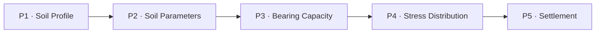

# GeoForge

**Geotechnical Analysis & Foundation Design**

*From Soil Data to Foundation Decisions.*

GeoForge is an interactive, browser-based toolkit for geotechnical analysis and preliminary shallow-foundation design. It brings soil characterization, laboratory parameter estimation, bearing capacity, stress distribution and settlement assessment into a single Streamlit workspace.

Designed for students, researchers and engineering practitioners, GeoForge supports user-defined soil profiles, groundwater conditions, footing geometries and loading scenarios. It is not restricted to a particular site, building or institution.

[](https://geotech-platform-acxehxhfdynfudwuvmh487.streamlit.app/)


## Analysis modules

| Module | Capabilities | Main methods and references |
| :--- | :--- | :--- |
| **P1 — Soil Profile** | Build and visualize layered soil profiles; define borehole details, soil classifications, unit weights, strength, stiffness and consolidation parameters; specify measured and design groundwater levels. | IS 1498 |
| **P2 — Soil Parameters** | Apply overburden and dilatancy corrections to SPT observations where applicable; fit drained Mohr–Coulomb strength parameters from direct-shear data; estimate undrained shear strength from UU triaxial tests. | IS 2131:1981 — Method for Standard Penetration Test for Soils , IS 2720 (Part 13):1986 — Direct Shear Test , IS 2720 (Part 11):1993 |
| **P3 — Bearing Capacity** | Estimate net ultimate and net safe bearing capacity; examine general and local shear, groundwater effects, inclination and effective-area corrections; size shallow footings for a selected factor of safety. | IS 6403:1981 |
| **P4 — Stress Distribution** | Compute vertical stress increments below rectangular loaded areas; compare centre and corner stresses with the 2:1 approximation; superpose stresses from multiple coplanar loaded areas. | Boussinesq theory; 2:1 method |
| **P5 — Settlement Analysis** | Estimate immediate settlement in granular soils and primary consolidation settlement in clay; explore time-dependent settlement and compare total and differential settlements with selected limits. | Schmertmann et al. (1978); Terzaghi 1-D consolidation; IS 8009:1976; IS 1904:1986 |

## Getting started

### Use the hosted application

[Launch GeoForge](https://geotech-platformgit-5hgqwskkbpyo8z2zykgfiq.streamlit.app/) in your browser. No local installation is required.

### Run locally

**Prerequisites:** Python 3.10 or newer, pip and Git.

Clone the repository:

```bash
git clone https://github.com/9Vaibhav8/GeoTech-Platform.git
cd GeoTech-Platform
```

Create a virtual environment and activate it for your operating system.

**Windows (PowerShell)**

```powershell
python -m venv .venv
.\.venv\Scripts\Activate.ps1
```

**macOS / Linux**

```bash
python3 -m venv .venv
source .venv/bin/activate
```

Install dependencies and start the application:

```bash
python -m pip install -r requirements.txt
python -m streamlit run Home.py
```

Open [http://localhost:8501](http://localhost:8501), or the local URL printed by Streamlit.

## Recommended workflow



The diagram represents a recommended analysis sequence, not automatic transfer of every calculated result.

1. **Define site conditions:** Enter soil-layer boundaries, soil properties and groundwater depths in P1. Replace illustrative defaults with verified site data.
2. **Interpret investigation data:** Enter SPT and laboratory test observations in P2. Review applicability, corrections and fitted parameters before applying results to the relevant soil layer.
3. **Assess bearing capacity:** Choose footing shape, dimensions, embedment, load conditions and factor of safety in P3. Inspect the intermediate factors and proposed footing sizes.
4. **Evaluate stress distribution:** Enter the selected geometry and appropriate net load or pressure in P4. Review the stress–depth curves and use superposition where applicable.
5. **Assess settlement:** Enter the actual footing dimensions, service loads, soil compressibility, drainage conditions and grid information in P5. Review settlement components, time curves and applicable settlement limits.

### Input checklist

| Input category | Typical data |
| :--- | :--- |
| Soil investigation | Borehole identifiers, layer depths, soil symbols and unit weights |
| Groundwater | Measured test-time and design water-table depths |
| Strength | SPT observations, direct-shear or UU triaxial results, cohesion and friction angle |
| Stiffness and consolidation | Elastic modulus, compression and recompression indices, initial void ratio, preconsolidation pressure and coefficient of consolidation |
| Foundation | Shape, width, length, founding depth, service loads, moments and factor of safety |
| Settlement assessment | Column layout and spacing, design period, drainage and applicable settlement criteria |

All calculations use SI units; settlements are reported in millimetres where indicated. Check the units shown next to each input before entering data.

## Architecture

GeoForge separates the Streamlit interface from its numerical calculation utilities. Shared soil-profile data is maintained in Streamlit session state and accessed by the relevant analysis pages.

Some fitted parameters must be explicitly applied to the soil profile. Foundation geometry and loads may require separate entry or confirmation on downstream pages. Session state is not a permanent project database, and users should retain their own records of inputs and results.

```text
GeoTech-Platform/
├── Home.py                         # Landing page and module navigation
├── pages/
│   ├── 1_🗺️_Soil_Profile.py
│   ├── 2_⚙️_Parameters.py
│   ├── 3_🏗️_Bearing_Capacity.py
│   ├── 4_📊_Stress_Increase.py
│   └── 5_📐_Settlement.py
├── utils/
│   ├── constants.py                # Shared inputs and defaults
│   ├── bearing_capacity.py         # Bearing capacity and footing sizing
│   ├── spt_corrections.py           # SPT corrections and strength fitting
│   ├── stress_increase.py           # Stress distribution calculations
│   ├── settlement.py                # Settlement and consolidation
│   └── Is1904.py                    # Settlement-limit and grid helpers
├── requirements.txt
└── README.md
```

## Technology stack

| Technology | Role |
| :--- | :--- |
| Python | Application logic and engineering calculations |
| Streamlit | Browser-based user interface and session state |
| NumPy / SciPy | Numerical computation |
| Pandas | Input tables and result summaries |
| Matplotlib | Soil-profile and laboratory-data plots |
| Plotly | Interactive engineering charts |

See [`requirements.txt`](requirements.txt) for the actual package requirements.

## Scope and limitations

GeoForge is intended for educational, research and preliminary engineering analysis of shallow foundations using the methods and standard editions identified in the application.

- Example inputs are illustrative, not recommended design parameters.
- Select soil parameters, correction methods and load conventions appropriate to the site. In particular, distinguish gross and net pressures and measured and design groundwater conditions.
- Empirical correlations and analytical models have limited applicability. Check the assumptions of the selected method, soil-profile coverage and the effects of stratification.
- Settlement assessments use simplified analytical models. They do not replace a comprehensive soil–structure interaction analysis, a coupled consolidation analysis or dedicated raft and deep-foundation design.
- A calculated factor of safety or settlement-limit check does not by itself establish foundation safety or regulatory compliance. Verify applicable standards, amendments and local requirements independently.

**Engineering review:** Results require independent verification by a qualified geotechnical or structural engineer before being used for actual construction or safety-critical decisions.

## Contributing

Contributions that improve numerical accuracy, input validation, documentation, usability or test coverage are welcome.

1. Fork the repository and create a branch for your change.
2. Keep engineering calculations in the relevant utility module and interface logic in the corresponding page.
3. Document equation sources, units, assumptions and any changes to numerical behaviour.
4. Test normal cases, boundary conditions and invalid inputs using representative soil profiles independent of the original case study.
5. Submit a pull request describing the change and the verification performed.

For bug reports or feature requests, use the [GitHub issues page](https://github.com/9Vaibhav8/GeoTech-Platform/issues). Include the affected module, input values, expected result and observed behaviour when reporting a calculation issue.

## References

- IS 1498 — *Classification and identification of soils for general engineering purposes*.
- IS 2131:1981 — *Method for standard penetration test for soils*.
- IS 6403:1981 — *Code of practice for determination of bearing capacity of shallow foundations*.
- IS 8009:1976, Part 1 — *Calculation of settlements of foundations*.
- IS 1904:1986 — *Code of practice for design and construction of foundations in soils: General requirements*.
- Schmertmann, J. H., Hartman, J. P., & Brown, P. R. (1978). “Improved strain influence factor diagrams.” *Journal of the Geotechnical Engineering Division*, 104(GT8), 1131–1135.
- Terzaghi, K. (1943). *Theoretical Soil Mechanics*. John Wiley & Sons.
- Das, B. M. (2016). *Principles of Foundation Engineering*, 8th ed. Cengage Learning.

## Project background

GeoForge originated as a civil engineering coursework project at IIT Mandi. The original hostel foundation problem is a motivating case study, not a restriction on the platform's intended application. The project-specific report and academic disclosures are maintained separately from this general-purpose user documentation.
